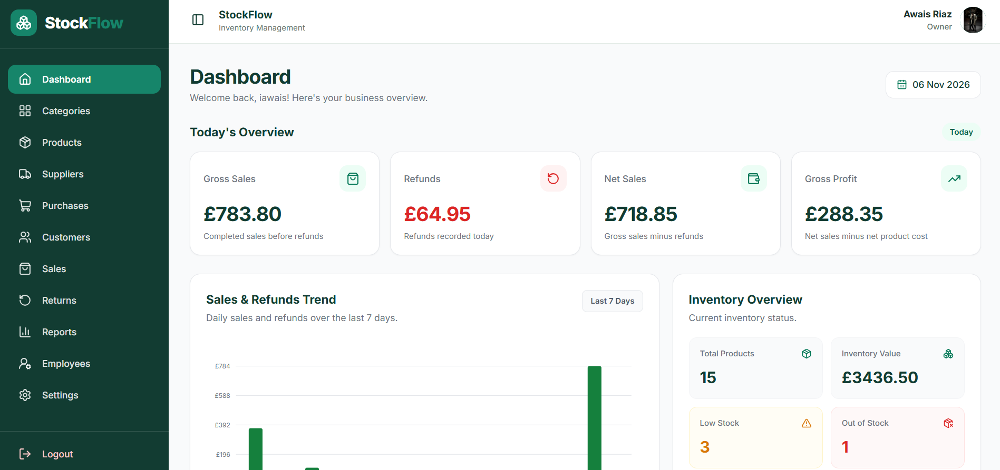
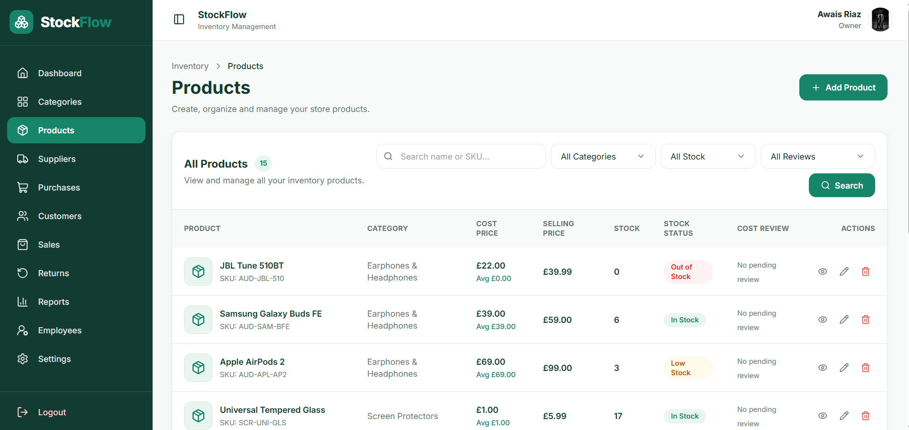
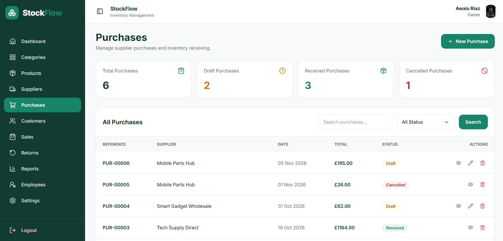
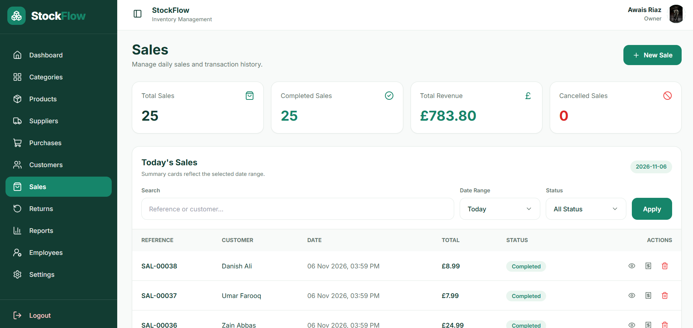
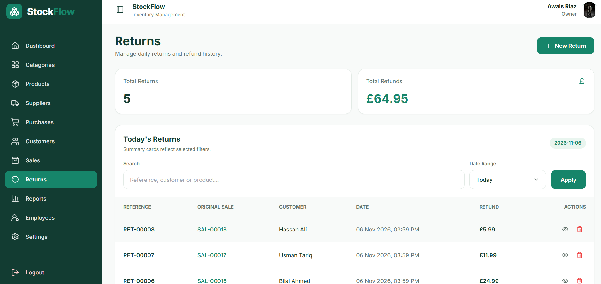
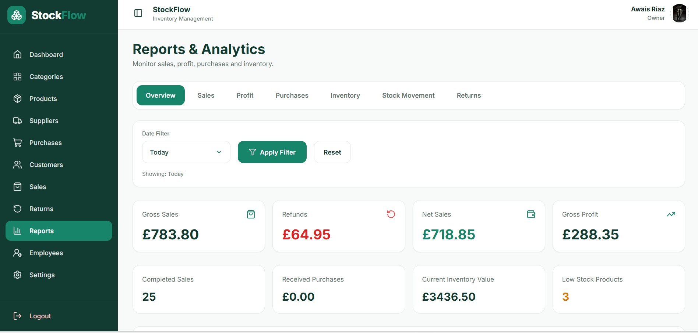

# StockFlow
### Inventory & Sales Management System

StockFlow is a web-based inventory and sales management application built with **Django and PostgreSQL**. It is designed to help small businesses manage their products, inventory, suppliers, purchases, customers, sales, returns, and business performance through a centralized dashboard.

The application includes employee management, role-based permissions, stock tracking, business reports, and a responsive user interface.

## Application Preview


## Features

### Dashboard
- Overview of daily sales, refunds, net sales, and gross profit.
- Sales and refunds trends.
- Inventory summary and stock alerts.
- Quick access to important business information.

### Categories & Products
- Create, update, and delete product categories.
- Manage product information, brands, SKUs, pricing, and stock quantities.
- Upload product images.
- Track stock availability and inventory costs.
- Search and filter products.

### Suppliers & Purchases
- Manage supplier contact information and status.
- Create purchase orders with multiple products.
- Track purchase statuses: Draft, Confirmed, Received, and Cancelled.
- Automatically update inventory when purchases are received.
- Review purchase details and history.

### Customers
- Maintain customer records.
- View customer purchase history.
- Track customer spending and repeat purchases.

### Sales Management
- Create sales transactions.
- Manage sold products, quantities, and prices.
- Automatically deduct sold quantities from inventory.
- View sales details and receipts.
- Cancel sales when permitted.

### Sales Returns
- Record returns against existing sales.
- Select returned products and quantities.
- Calculate refund amounts.
- Manage inventory adjustments when items are restocked.
- View return history.

### Reports & Analytics
- Business performance overview.
- Sales and profitability reports.
- Purchase reports.
- Inventory reports.
- Stock movement history.
- Returns and refunds reports.
- Date-based filtering.

### Employees & Permissions
- Owner-managed employee accounts.
- Assign permissions for individual modules.
- Control View, Add, Edit, and Delete access where supported.
- Restrict unauthorized access to protected pages.
- Separate business-owner and employee responsibilities.

### Business Settings
- Manage personal and business information.
- Update profile pictures and business logos.
- Change account passwords.
- Manage account settings.

## Tech Stack

| Technology | Purpose |
|---|---|
| Python | Backend programming language |
| Django | Web application framework |
| PostgreSQL | Relational database |
| pgAdmin | PostgreSQL database administration |
| HTML5 | Page structure |
| Tailwind CSS | Responsive user interface |
| JavaScript | Interactive frontend functionality |
| Git & GitHub | Version control and source code hosting |

## Screenshots

### Dashboard



### Product Management



### Purchase Management



### Sales Management



### Returns Management



### Reports & Analytics



### Employee Permissions


### Business Settings


Additional screenshots are available in the [screenshots directory](screenshots/).

## Installation & Setup

### Prerequisites

Before running StockFlow, make sure the following are installed:

- Python
- PostgreSQL
- Git
- pip
- A code editor such as Visual Studio Code

pgAdmin is optional and can be used to manage the PostgreSQL database.

### 1. Clone the Repository

```bash
git clone https://github.com/iawaisriaz/StockFlow.git
cd StockFlow
```

### 2. Create a Virtual Environment

```bash
python -m venv .venv
```

Activate the virtual environment.

**Windows PowerShell:**

```powershell
.\.venv\Scripts\Activate.ps1
```

**macOS / Linux:**

```bash
source .venv/bin/activate
```

### 3. Install Dependencies

```bash
python -m pip install -r requirements.txt
```

### 4. Configure PostgreSQL

Create a PostgreSQL database named:

```text
stockflow_db
```

You can create the database using pgAdmin or PostgreSQL command-line tools.

Ensure your PostgreSQL user has the necessary permissions to access and manage the database.

### 5. Configure Environment Variables

Create a `.env` file in the project root directory.

You can copy the example configuration:

**Windows PowerShell:**

```powershell
Copy-Item .env.example .env
```

**macOS / Linux:**

```bash
cp .env.example .env
```

Update the `.env` file with your own configuration:

```dotenv
DJANGO_SECRET_KEY=your_secret_key
DJANGO_DEBUG=True
DJANGO_ALLOWED_HOSTS=127.0.0.1,localhost

DB_NAME=stockflow_db
DB_USER=your_postgresql_username
DB_PASSWORD=your_postgresql_password
DB_HOST=127.0.0.1
DB_PORT=5432

MAIL_HOST=smtp.gmail.com
MAIL_PORT=587
MAIL_USERNAME=your_email@gmail.com
MAIL_PASSWORD=your_gmail_app_password
MAIL_USE_TLS=True
DEFAULT_FROM_EMAIL=your_email@gmail.com
```

**Security:** Never commit your `.env` file, database passwords, email credentials, or Django secret key to GitHub.

### 6. Apply Database Migrations

```bash
python manage.py migrate
```

This creates the required database tables using the project's Django migrations.

### 7. Run the Development Server

```bash
python manage.py runserver
```

Open the application in your browser:

http://127.0.0.1:8000/

### 8. Create an Account

Register through the application signup page to create your business account.

After signing in, configure your business information and begin managing inventory.

## Project Structure

```text
StockFlow/
├── accounts/
├── categories/
├── config/
├── core/
├── customers/
├── dashboard/
├── employees/
├── products/
├── purchases/
├── reports/
├── returns/
├── sales/
├── screenshots/
├── static/
├── suppliers/
├── templates/
├── .env.example
├── .gitignore
├── manage.py
├── requirements.txt
├── README.md
└── StockFlow_User_Manual.docx
```

## User Roles & Access Control

StockFlow provides two primary user roles.

**Business Owner**

The business owner manages the business, its employees, inventory, sales, purchases, reports, and permissions.

**Employee**

Employees access only the modules and actions authorized by the business owner. Permissions are checked on the backend, helping prevent unauthorized operations.

## User Manual

A detailed user manual is included in the repository.

[View StockFlow User Manual](StockFlow_User_Manual.docx)

The manual explains the application interface, navigation, inventory operations, purchases, sales, returns, reporting, and employee management.

## Security

StockFlow includes:

- Django authentication and password validation.
- Password-reset functionality using email.
- Role-based employee permissions.
- Protected application views.
- CSRF protection through Django.
- Environment-based configuration for database and email credentials.

**Note:** This repository is intended for development and portfolio demonstration. A production deployment requires appropriate security settings, HTTPS, deployment configuration, and further testing.

## Project Status

**Portfolio Project — Developed**

The application includes the core inventory, sales, purchases, returns, reporting, and employee-management modules.

## Author

**Awais Riaz**

Software Developer — Full-Stack & Back-End Development

London, United Kingdom

GitHub: [@iawaisriaz](https://github.com/iawaisriaz)

---

Built with Python, Django, PostgreSQL, Tailwind CSS, and JavaScript.
